# Microsoft 365 Onboarding & Offboarding

During my IT Support internship at Nowcloud, a big part of my week was setting up new starters and removing access for people who were leaving. I processed 20+ of these requests in the Microsoft 365 admin center and Entra ID.

I wanted to understand the process properly rather than just click through it, so I rebuilt it in my own Microsoft 365 test tenant as PowerShell scripts, with checklists for the steps that can't be automated. This repo has the scripts, the runbooks, and screenshots from testing the full joiner-to-leaver cycle.

> No client data from the internship is included. Everything here was built and tested in my own Business Premium trial tenant (`SasiLab`) using made-up users.

## What's in here

| | What it does |
|---|---|
| [`scripts/New-M365User.ps1`](scripts/New-M365User.ps1) | Creates one user, or a batch from a CSV. Assigns a licence and groups, and sets a random temp password that has to be changed at first sign-in. Skips anyone who already exists. |
| [`scripts/Start-M365Offboarding.ps1`](scripts/Start-M365Offboarding.ps1) | Removes a leaver's access: blocks sign-in, revokes sessions, resets the password, removes groups, converts the mailbox to shared for their manager, sets an auto-reply and reclaims the licence. Supports `-WhatIf` to preview first. |
| [`scripts/Get-M365LicenceReport.ps1`](scripts/Get-M365LicenceReport.ps1) | Exports every user's licence and sign-in status, and flags disabled accounts still holding a licence or accounts nobody has used in 90 days. |
| [`docs/`](docs) | Onboarding and offboarding checklists, plus [what I learned](docs/lessons-learned.md) along the way |
| [`samples/new-starters.csv`](samples/new-starters.csv) | Example input for bulk onboarding |

## How the process works

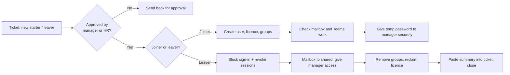

## Testing it end to end

### 1. Onboarding a new starter

The first run didn't go to plan. The user was created, but the licence failed with a `409` error, and the script still printed "Licence assigned". (More on that in [Problems I hit](#problems-i-hit-and-how-i-fixed-them) below.)

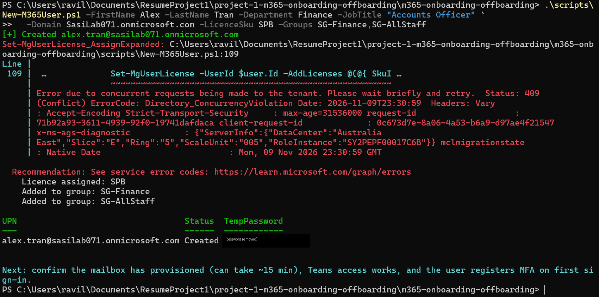

After fixing the script and assigning the licence, the user showed up licensed and in the right groups:

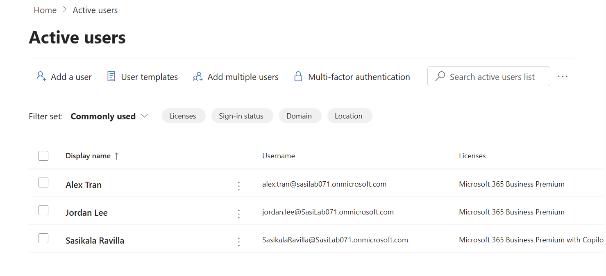

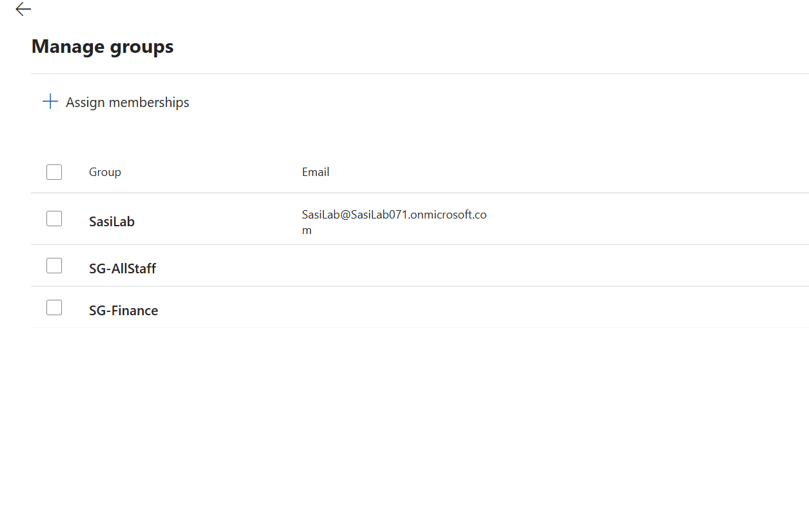

### 2. Bulk onboarding from a CSV

Next I onboarded the rest of the CSV. Alex was skipped because he already existed, which is what should happen with a duplicate request. Sam hit the same licence timing issue as before, and this time the script waited 5 seconds, retried and succeeded on its own.

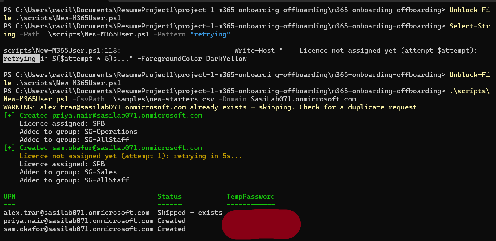

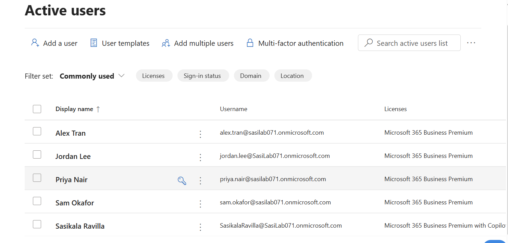

I signed in as the new user to make sure the account and mailbox actually worked:

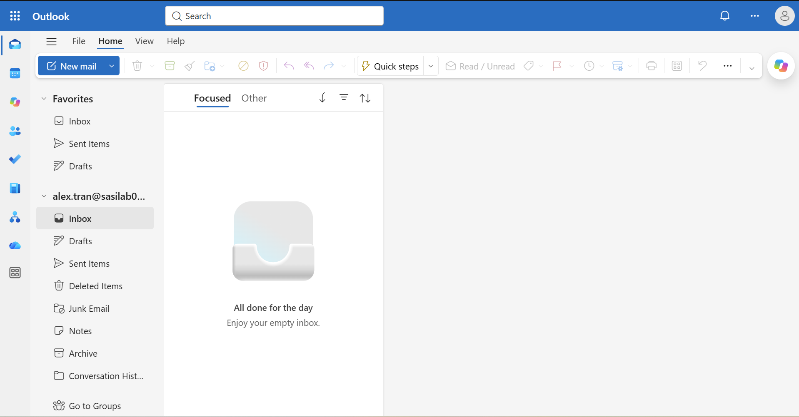

### 3. Offboarding, previewed first

Before changing anything, I ran the offboarding with `-WhatIf`. It lists every step it would take, in order, without touching the account.

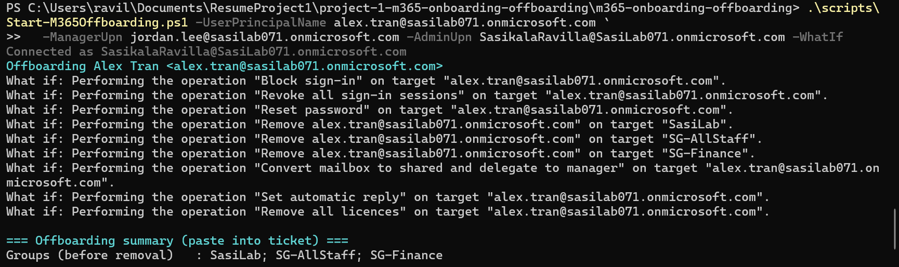

Then I ran it for real. The script prints a summary that can go straight into the ticket:

```
=== Offboarding summary (paste into ticket) ===
Sign-in blocked           : Yes
Sessions revoked          : Yes
Password reset            : Yes
Groups (before removal)   : SasiLab; SG-AllStaff; SG-Finance
Mailbox                   : Shared, FullAccess -> jordan.lee@sasilab071.onmicrosoft.com, hidden from GAL
Auto-reply                : Enabled
Licences reclaimed        : cbdc14ab-d96c-4c30-b9f4-6ada7cdc1d46
```

The licence came out as an ID rather than a name, which isn't much use in a ticket, so I changed the script to show the licence name (`SPB`) instead.

### 4. Checking the leaver really has no access

The mailbox was converted to shared, so the manager keeps the emails without needing a licence:

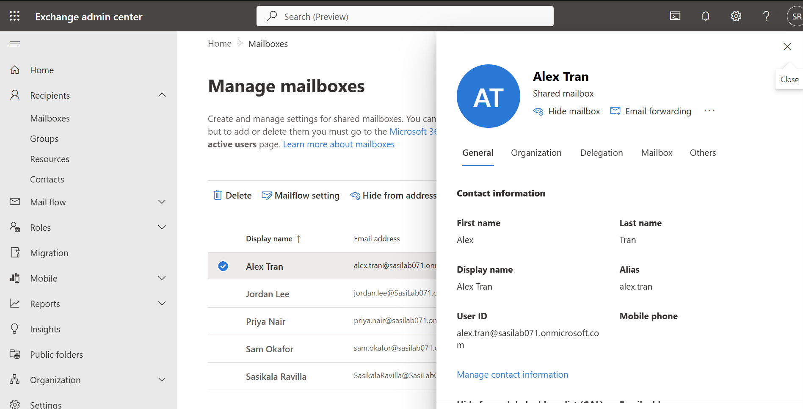

Trying to sign in as the leaver gets blocked:

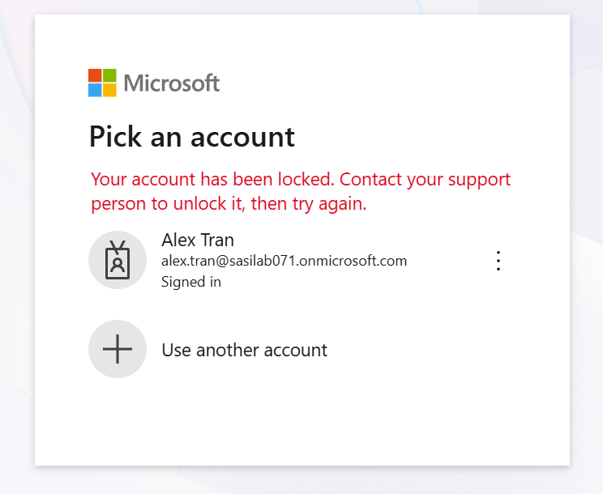

And anyone who emails them gets pointed to their manager:

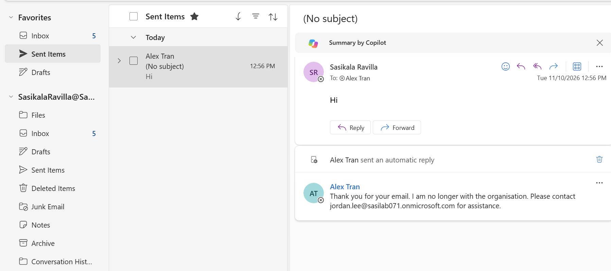

### 5. Licence report

The report confirmed the offboarding was clean. The leaver is disabled with no licence, and the licence went back into the pool (3 of 25 used).

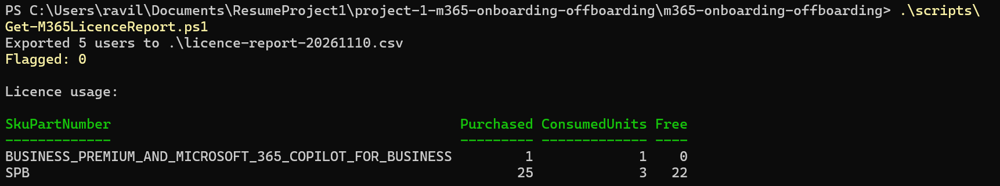

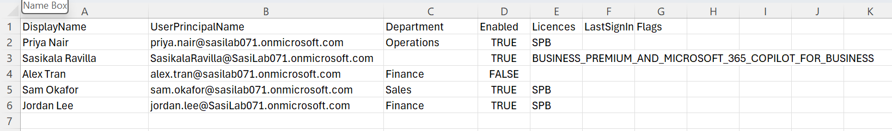

To check the report would actually catch a mistake, I blocked another user's sign-in but left their licence on. The report flagged it:

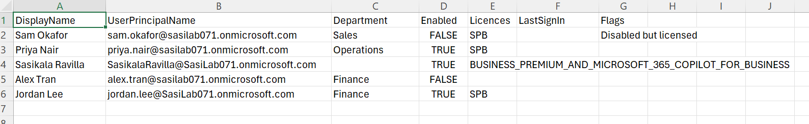

## Problems I hit and how I fixed them

| Problem | What was going on | How I fixed it |
|---|---|---|
| Licence assignment failed with `409 Directory_ConcurrencyViolation`, but the script said "Licence assigned" anyway | The new account hadn't finished syncing across Microsoft's servers yet. The error was *non-terminating*, so PowerShell just carried on to the next line. | Added `-ErrorAction Stop` and a retry loop that waits a bit longer each time. It only says "assigned" if it really worked. It fixed itself on the next run. |
| The licence report crashed with *"the array index evaluated to null"* | The user I had just offboarded had no licences, and I hadn't handled that case | Skip empty licence entries before looking up the licence name |
| The report said "Exported" even though the CSV wasn't saved | I had the CSV open in Excel, which locks the file | Same fix as the first one: `-ErrorAction Stop`, so a failed save shows as a failure |
| The offboarding stopped with "User canceled authentication" | The Exchange Online sign-in window had opened behind PowerShell | Connected to Exchange first, added an `-AdminUpn` option, and made the script reuse existing connections |
| Signing in to Graph said *"That Microsoft account doesn't exist"* | Windows sent me to the personal Microsoft account login instead of the work one | Picked **Work or school account** |

The common thread in the first three: a command can fail without stopping the script, so you can get a success message straight after an error. I now use `-ErrorAction Stop` on anything that matters.

## Running it yourself

You'll need PowerShell 7, the [Microsoft Graph PowerShell SDK](https://learn.microsoft.com/powershell/microsoftgraph/installation) and the [Exchange Online module](https://learn.microsoft.com/powershell/exchange/exchange-online-powershell-v2):

```powershell
Install-Module Microsoft.Graph -Scope CurrentUser
Install-Module ExchangeOnlineManagement -Scope CurrentUser
```

The admin account needs **User Administrator**, **License Administrator** and **Exchange Administrator** roles. Global Admin works, but isn't needed.

```powershell
# Onboard one user
.\scripts\New-M365User.ps1 -FirstName Alex -LastName Tran -Department Finance -JobTitle "Accounts Officer" `
    -Domain contoso.onmicrosoft.com -LicenceSku SPB -Groups SG-Finance,SG-AllStaff

# Onboard from a CSV
.\scripts\New-M365User.ps1 -CsvPath .\samples\new-starters.csv -Domain contoso.onmicrosoft.com

# Preview an offboarding, then run it
.\scripts\Start-M365Offboarding.ps1 -UserPrincipalName alex.tran@contoso.onmicrosoft.com `
    -ManagerUpn jordan.lee@contoso.onmicrosoft.com -AdminUpn admin@contoso.onmicrosoft.com -WhatIf
.\scripts\Start-M365Offboarding.ps1 -UserPrincipalName alex.tran@contoso.onmicrosoft.com `
    -ManagerUpn jordan.lee@contoso.onmicrosoft.com -AdminUpn admin@contoso.onmicrosoft.com

# Licence report
.\scripts\Get-M365LicenceReport.ps1
```

`SPB` is the licence name for Microsoft 365 Business Premium. Run `Get-MgSubscribedSku | Select SkuPartNumber` to see the ones in your tenant.

## Security points I kept in mind

- **Revoke sessions, don't just block sign-in.** Otherwise a leaver's phone can stay signed in to Outlook or Teams for a while.
- **Convert the mailbox before removing the licence.** Shared mailboxes don't need a licence, but removing the licence first puts the mailbox on the path to deletion.
- **Temp passwords never go in tickets or emails.** They're shown once, given to the manager directly, and must be changed at first sign-in.
- **Preview before changing anything.** Offboarding supports `-WhatIf`.
- **Every run is logged**, so there's an audit trail for the ticket.

## Skills used

Microsoft 365 admin center · Entra ID users, groups and licensing · Exchange Online · Microsoft Graph PowerShell · PowerShell error handling and retry logic · troubleshooting · least privilege · process documentation
